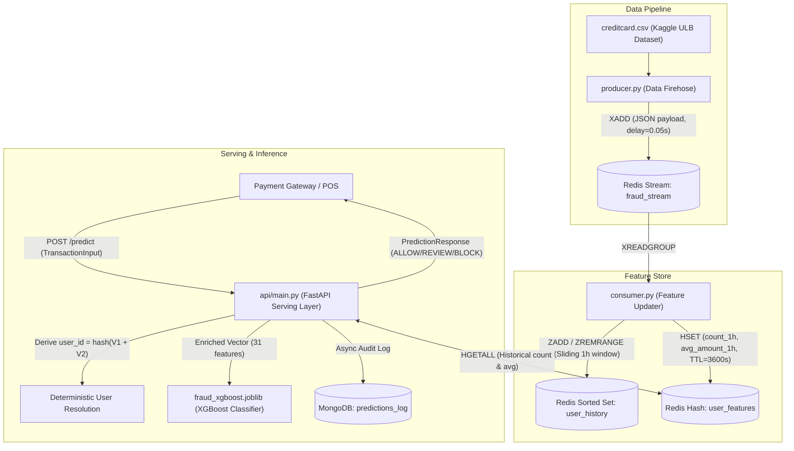

# Real-Time Fraud Detection Engine

A production-grade, low-latency, end-to-end Machine Learning Fraud Detection Engine built with **FastAPI**, **Redis Streams & Hashes**, **MongoDB**, and **XGBoost**.

---

## 🏗️ Architecture Overview



---

## 📦 System Components

1. **`docker-compose.yml`**: Provisions containerized Redis (alpine, port 6379) and MongoDB (latest, port 27017) with local Docker volume persistence.
2. **`producer.py`**: Reads `creditcard.csv` and continuously publishes JSON-serialized transactions to Redis Stream `fraud_stream` with configurable delays (`time.sleep(0.05)`).
3. **`consumer.py`**: Consumes from `fraud_stream`, resolves deterministic mock `user_id` from `hash(V1 + V2)`, and maintains rolling 1-hour `transaction_count_1h` and `avg_amount_1h` features in Redis Hashes using Redis TTLs.
4. **`train_model.py`**: Loads `creditcard.csv`, constructs identical rolling 1-hour features with no data leakage (`closed='left'`), trains an `XGBClassifier` optimized for Precision-Recall AUC (`aucpr`), and exports `fraud_xgboost.joblib`.
5. **`api/schemas.py`**: Strict Pydantic models for `TransactionInput` (Features `V1`..`V28` + `Amount`) and `PredictionResponse` (`transaction_id`, `fraud_probability`, `action`).
6. **`api/main.py`**: Low-latency FastAPI serving application that queries the Redis feature store, enriches incoming transactions, performs XGBoost inference, asynchronously logs audits to MongoDB, and returns automated decisions.
7. **`config.py` & `.env`**: Centralized configuration management using `pydantic-settings` with zero hardcoded credentials.

---

## 🚀 Quick Start Guide

### 1. Prerequisites & Environment Setup
Clone the repository and install dependencies:
```bash
py -m pip install -r requirements.txt
```

Copy the environment template:
```bash
copy .env.example .env
```

### 2. Start Infrastructure (Docker Compose)
Launch Redis and MongoDB containers:
```bash
docker-compose up -d
```
Verify running services:
```bash
docker-compose ps
```

### 3. Obtain Dataset & Train the XGBoost Model
Ensure `creditcard.csv` is in the project root (downloaded from Kaggle MLG-ULB):
```bash
# If using Kaggle CLI:
kaggle datasets download -d mlg-ulb/creditcardfraud
unzip creditcardfraud.zip
```

Run the model training pipeline:
```bash
py train_model.py
```
This engineers the rolling features, evaluates the test set with Precision-Recall AUC (PR-AUC), and exports `fraud_xgboost.joblib`.

### 4. Start the Feature Pipeline
In Terminal 1, run the **Feature Consumer**:
```bash
py consumer.py
```

In Terminal 2, run the **Transaction Producer** (Firehose):
```bash
py producer.py --sleep 0.05
```

### 5. Launch the FastAPI Serving Engine
In Terminal 3, run the API:
```bash
py -m uvicorn api.main:app --host 0.0.0.0 --port 8000 --reload
```

Interactive OpenAPI Swagger UI is accessible at:
`http://localhost:8000/docs`

---

## 🔍 API Usage & Examples

### Health Check
```bash
curl -X GET "http://localhost:8000/health"
```
**Response:**
```json
{
  "status": "HEALTHY",
  "model_loaded": true,
  "model_path": "fraud_xgboost.joblib",
  "redis_connected": true,
  "mongo_connected": true,
  "timestamp": "2026-11-03T10:45:00Z"
}
```

### Predict Fraud Risk
```bash
curl -X POST "http://localhost:8000/predict" \
     -H "Content-Type: application/json" \
     -d '{
       "transaction_id": "tx_live_1001",
       "Amount": 249.50,
       "V1": -1.359807,
       "V2": -0.072781,
       "V3": 2.536347,
       "V4": 1.378155,
       "V5": -0.338321,
       "V6": 0.462388,
       "V7": 0.239599,
       "V8": 0.098698,
       "V9": 0.363787,
       "V10": 0.090794,
       "V11": -0.551600,
       "V12": -0.617801,
       "V13": -0.991390,
       "V14": -0.311169,
       "V15": 1.468177,
       "V16": -0.470401,
       "V17": 0.207971,
       "V18": 0.025791,
       "V19": 0.403993,
       "V20": 0.251412,
       "V21": -0.018307,
       "V22": 0.277838,
       "V23": -0.110474,
       "V24": 0.066928,
       "V25": 0.128539,
       "V26": -0.189115,
       "V27": 0.133558,
       "V28": -0.021053
     }'
```
**Response:**
```json
{
  "transaction_id": "tx_live_1001",
  "fraud_probability": 0.001248,
  "action": "ALLOW",
  "user_id": "user_2145",
  "historical_count_1h": 2,
  "historical_avg_amount_1h": 124.75
}
```

### Decision Thresholds
- `fraud_probability < 0.20` ➔ `ALLOW`
- `0.20 <= fraud_probability < 0.80` ➔ `REVIEW`
- `fraud_probability >= 0.80` ➔ `BLOCK`

---

## 🧪 Automated Testing
Run the test suite:
```bash
py -m pytest tests/test_system.py -v
```

